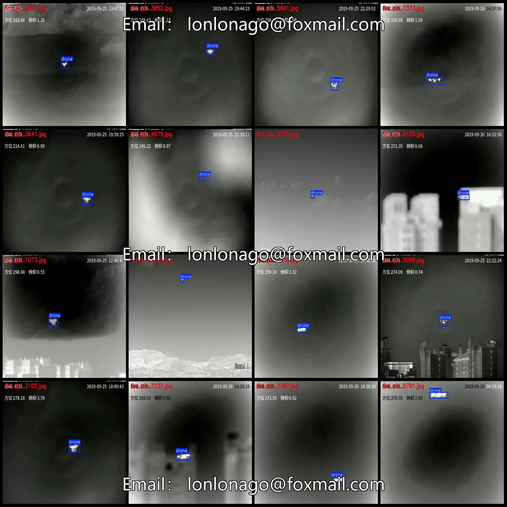
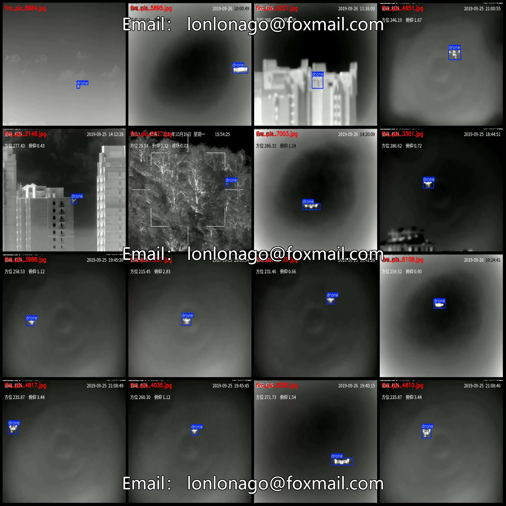
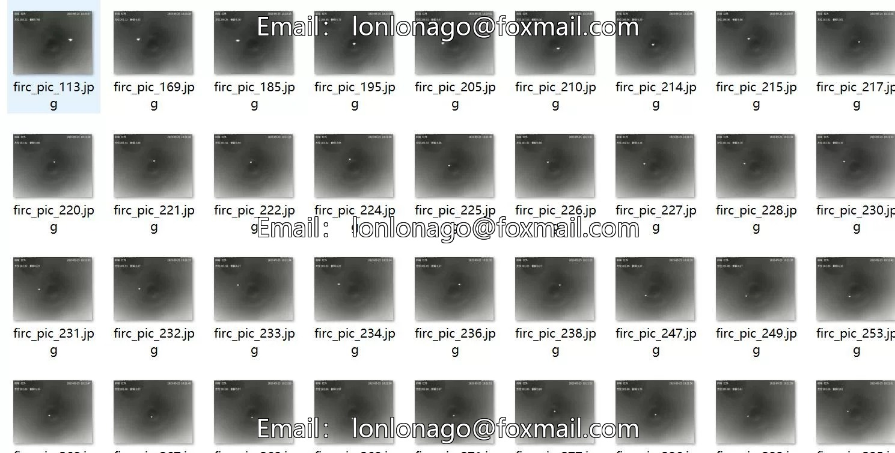
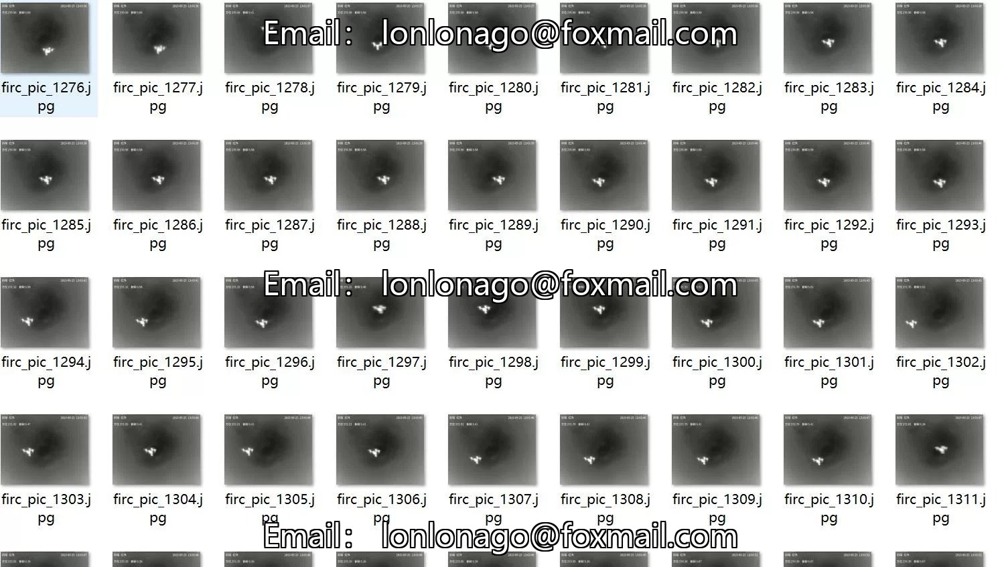
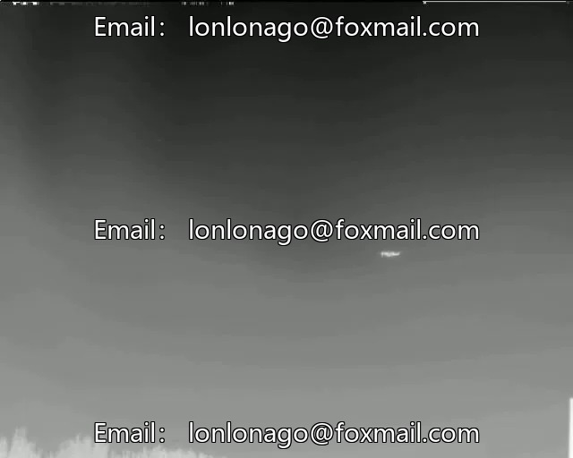
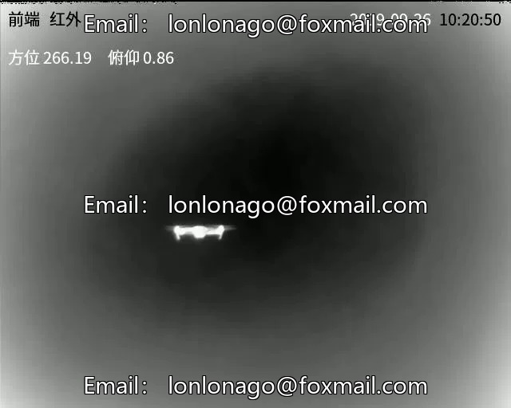
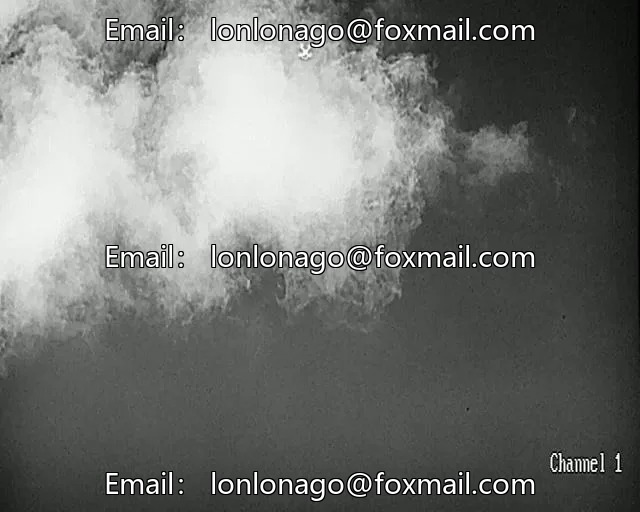

# Infrared Thermal Imaging Image UAV Recognition Detection Dataset VOC+YOLO format 100

## Body

1. Instructions:
- Due to the dataset's replicability, please confirm compliance with requirements before purchasing.
- The dataset format is Pascal VOC+YOLO (txt files without split paths, only containing jpg images and corresponding VOC and YOLO formatted xml and txt files).
- Number of images (jpg file count): 10,000
- Number of annotations (xml file count): 10,000
- Number of annotations (txt file count): 10,000
- Number of annotation categories: 1
- Annotation category names: ["drone"]

Drone Frames = 10,000, Image Count = 10,000
Total Frames: 10,000
Image Resolution: 640x512
Labeling Tool: labelImg
Labeling Rules: Draw a rectangle around the category.
Important Notice: The dataset does not include splitting into training, validation, and test sets; you need to do this yourself.
Special Remark: This dataset does not guarantee the accuracy of the trained models or weight files.

## Images

## Payment

Here is a pay link on Stripe ( https://buy.stripe.com/3cs8yP7sY87d0vu9AB ). Please contact me lonlonago@foxmail.com after funding $89, and I will send you a complete data files , thank you!

